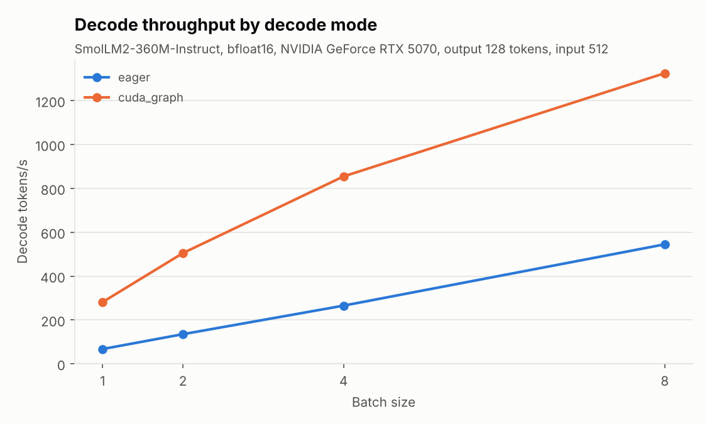
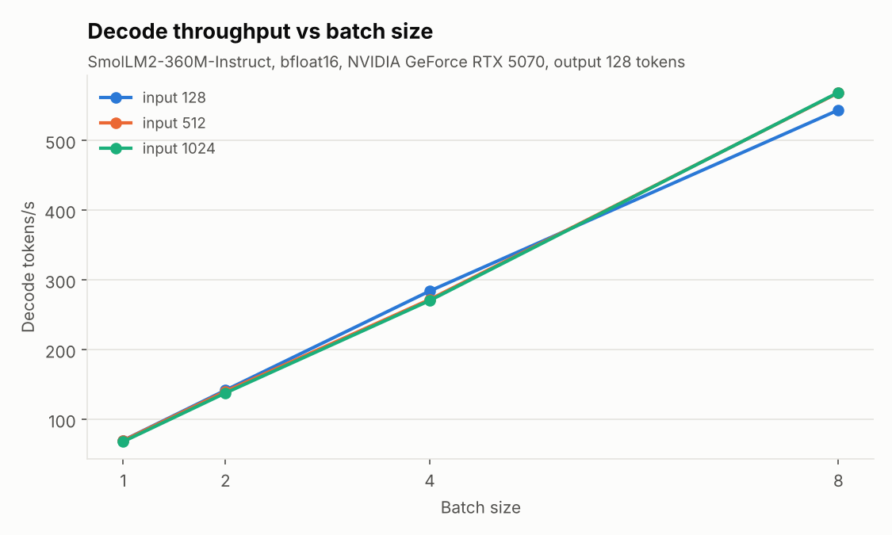
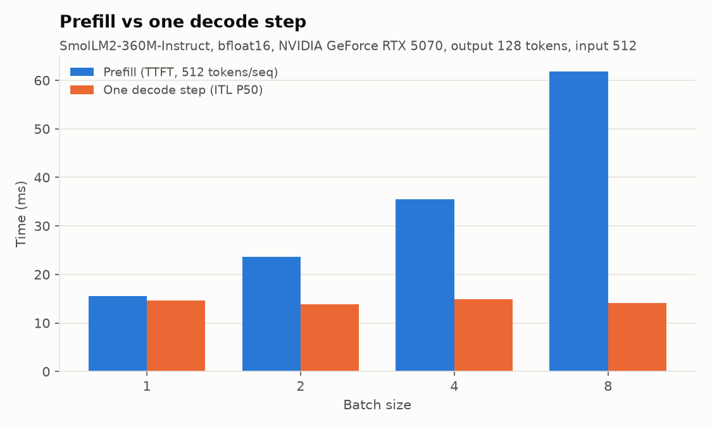
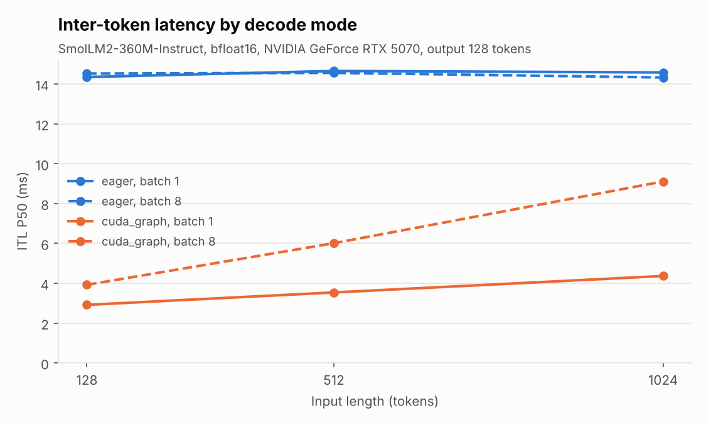
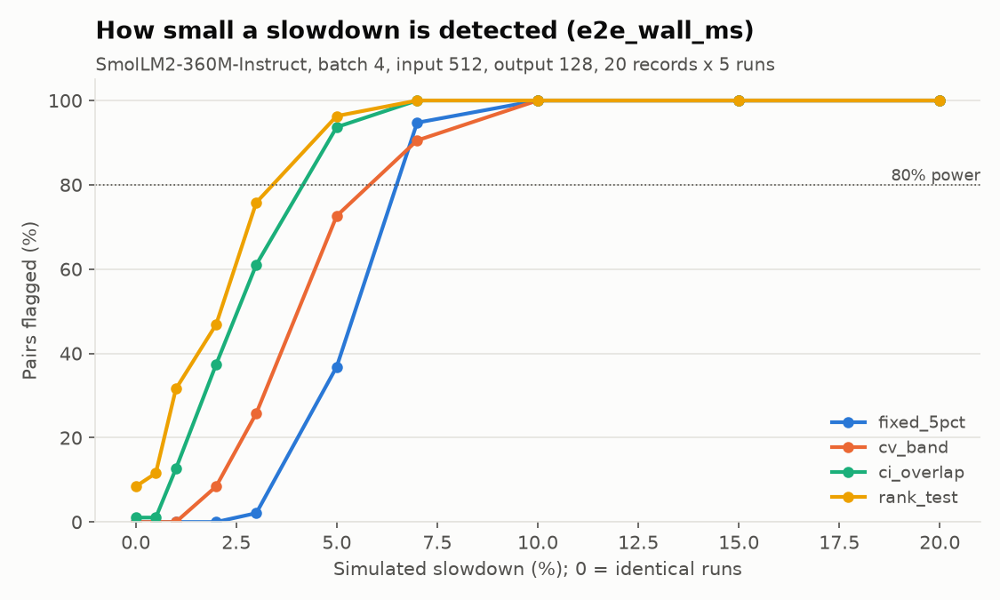

# MiniInferBench

A small, reproducible benchmark harness for LLM inference on a single GPU.

It drives a Hugging Face model with a hand-written prefill + decode loop, times
every step, checks the output token by token against `generate()`, and writes
one classified record per run (config, environment, raw samples, evidence).
Every number below comes from a record in [`results-published/`](results-published/).

## At a glance

On SmolLM2-360M and an RTX 5070 (WSL2):

1. **Found the bottleneck.** Decode was launch-bound: about 1,300 kernel
   launches per step, with the GPU busy only 19% of the time.
2. **Tested the fix and split the credit.** A static KV cache alone made decode
   10% slower; operator fusion cut inter-token latency from 14.8 to 6.0 ms; CUDA
   graphs brought it to 4.1 ms (3.6x faster, GPU busy 95%), with output still
   matching `generate()`. See [the ablation](#ablation-what-each-part-contributes).
3. **The harness caught real bugs.** The token-level check against `generate()`
   found two configuration bugs in the reference itself, and an injected
   host-sync regression showed up in P99 latency (+70%) while the median stayed
   flat.

4. **Measured the harness's own error rates.** On 190 pairs of identical
   runs, a bootstrap test raised false alarms 13% to 26% of the time and a
   fixed 5% rule on P99 latency 61% to 82%; the rule the harness shipped with
   never did, but caught a 10% slowdown only 28% of the time. See
   [How far can a comparison be trusted?](#how-far-can-a-comparison-be-trusted)
5. **Extended it to training.** A training step is timed only after it is
   shown to train; two injected "fast but not learning" faults are rejected.
6. **Built a diagnosis task set with known answers.** 45 injected slowdowns
   and 25 controls. Trace rules named the right root cause for all 14 faults
   they flagged and raised no false alarm, but with 5 runs per side half of
   the real slowdowns went unnoticed. The first run of the suite also exposed
   a flaw in its own method: timing after profiling in the same process.



## Results: SmolLM2-360M on an RTX 5070

Setup: `HuggingFaceTB/SmolLM2-360M-Instruct`, bfloat16, greedy, synthetic
prompts (seeded, fixed length), EOS ignored so every run does the same work.
RTX 5070 12 GB (SM120), WSL2, torch 2.11.0+cu128, transformers 5.22.1.
2 warmup runs + 5 measured runs per point; all records produced at commit
`00da9fe` with a clean tree.

Sweep `5070-360m-v3`: batch {1,2,4,8} x input {128,512,1024} x output {32,128,256}.
All 36 points match `generate()` exactly; 20 are `ok`, 16 `unstable`
(see [Limitations](#limitations)). Full table: `mib table --tag 5070-360m-v3
--results results-published/5070-360m-v3.jsonl`.

| Batch | Input | Output | Status | TTFT (ms) | ITL P50 (ms) | ITL P99 (ms) | Decode tok/s | Peak mem |
| --- | --- | --- | --- | --- | --- | --- | --- | --- |
| 1 | 512 | 128 | ok | 15.50 | 14.58 | 16.94 | 69.65 | 744 MiB |
| 2 | 512 | 128 | ok | 23.67 | 13.89 | 42.00 | 140.27 | 776 MiB |
| 4 | 512 | 128 | ok | 35.46 | 14.86 | 30.66 | 272.14 | 838 MiB |
| 8 | 512 | 128 | unstable | 61.81 | 14.12 | 26.95 | 568.62 | 965 MiB |
| 8 | 1024 | 256 | ok | 135.97 | 14.39 | 17.40 | 561.67 | 1215 MiB |



**Finding 1: decode time is set by launching kernels, not by GPU compute.**
(Later evidence narrows where: the calling thread has slack, see
[How far can a comparison be trusted?](#how-far-can-a-comparison-be-trusted))

- ITL P50 stays between 13.9 and 14.9 ms at every point with output 128 or
  256, whatever the batch size or input length, so decode throughput grows almost linearly with batch size
  (about 70 → 140 → 272 → 560 tokens/s).
- Profiler traces (`results-published/traces/`) show about 1,300 kernel
  launches per decode step. The GPU is busy for only 3.6 ms (batch 1) to 4.5 ms
  (batch 8) of a ~14.5 ms step.
- Prefill of 128 tokens at batch 1 (TTFT 14.7 ms) costs about the same as one
  decode step: both are dominated by the same per-layer launch sequence.

The direct test of this finding is to remove the launches; see
[Testing the finding with CUDA Graphs](#testing-the-finding-with-cuda-graphs).



More figures: [latency vs batch](docs/figures/latency_vs_batch.png),
[prefill vs input length](docs/figures/prefill_vs_input.png),
[ITL distribution](docs/figures/itl_distribution.png),
[memory: measured vs estimated](docs/figures/memory.png).

## Testing the finding with CUDA Graphs

If decode is launch-bound, replaying each decode step as one CUDA graph
instead of ~1,300 separate launches should cut ITL to roughly the GPU's busy
time. `decode_mode: "cuda_graph"` does that: a static KV cache plus
`torch.compile(mode="reduce-overhead")` for decode steps; prefill stays eager.
Both modes were swept at the same commit, output 128
([`results-published/5070-360m-modes.jsonl`](results-published/5070-360m-modes.jsonl)).

| Batch | Input | ITL P50 eager | ITL P50 CUDA graph | Decode tok/s eager | Decode tok/s CUDA graph |
| --- | --- | --- | --- | --- | --- |
| 1 | 128 | 14.35 ms | 2.92 ms | 69.6 | 341.0 |
| 1 | 1024 | 14.58 ms | 4.37 ms | 67.1 | 228.2 |
| 4 | 512 | 14.73 ms | 4.66 ms | 265.2 | 854.5 |
| 8 | 128 | 14.53 ms | 3.92 ms | 544.8 | 2028.2 |
| 8 | 1024 | 14.33 ms | 9.11 ms | 556.7 | 874.7 |



- **Decode got 1.6x to 4.9x faster**, and at batch 4, input 512 the GPU was
  busy 95% of each step instead of 19%. The batch-1, input-128 ITL of 2.9 ms is
  close to the 3.6 ms of GPU busy time the eager trace showed. But
  `reduce-overhead` does two things at once (operator fusion and CUDA graphs),
  so this sweep alone does not say which one helped. The ablation below does.
- **The bottleneck moved to the GPU.** In eager mode ITL is flat at ~14.5 ms
  whatever the batch or input length. With graphs it grows with both (batch 8:
  3.9 ms at input 128, 9.1 ms at input 1024), because reading the KV cache now
  shows. The largest GPU cost after the matmuls is attention: with a static
  cache SDPA uses the memory-efficient kernel with an explicit mask over the
  full cache length (175 ms total in the trace vs 42 ms for flash split-KV in
  eager mode), so that is the next thing to fix.
- **Correctness under a different kernel path.** 8 of 12 graph-mode points
  diverged from `generate()` somewhere, always between tokens whose logits
  were tied in bf16 or one bf16 step apart (largest gap 0.19 logits, within
  the 0.25 tolerance); a float32 control run at batch 4 matched exactly. These
  points are recorded as `near_tie` with every divergence kept.
- **Costs.** Peak memory is higher (2.2 GiB vs 1.2 GiB at batch 8, input 1024:
  the static cache and the graph memory pool), compilation adds several seconds,
  and graph mode needs longer warmup (6 runs instead of 2).

### Ablation: what each part contributes

Two extra modes isolate the parts: `static` (static KV cache, no compilation)
and `compiled` (static cache plus `torch.compile(mode="default")`: fusion, no
graphs). Same commit, same inputs, output 128
([`results-published/ablation.jsonl`](results-published/ablation.jsonl);
traces for batch 4 in [`results-published/traces/`](results-published/traces/)).

| Mode | What changes | ITL P50, bs4 in512 | ITL P50, bs1 in128 | Kernels per step (bs4) | GPU busy (bs4) |
| --- | --- | --- | --- | --- | --- |
| `eager` | baseline | 14.78 ms | 14.34 ms | 1,334 | 19% |
| `static` | + static KV cache | 16.27 ms (+10%) | 17.07 ms (unstable) | 1,565 | 23% |
| `compiled` | + operator fusion | 6.05 ms (-59%) | 6.53 ms | 579 | 50% |
| `cuda_graph` | + CUDA graphs | 4.05 ms (-73%) | 2.92 ms (-80%) | 580, in 1 graph launch | 95% |

- **The static cache alone is slower.** It is needed for graphs (fixed
  shapes and addresses) but makes SDPA use the memory-efficient kernel with a
  mask over the whole cache, and adds mask and cache-update kernels: 231
  more kernels and ~1.9 ms more GPU time per step.
- **Fusion gives most of the gain.** Inductor fuses 1,565 kernels into 579.
  GPU busy time per step barely changes (~4.0 ms in eager, compiled and graph
  traces), so the saving is launch overhead, which confirms that decode was
  launch-bound.
- **Graphs remove the remaining launches.** The 579 kernels are replayed with
  one graph launch per step. This matters more when the GPU work per step is
  small: at batch 4 graphs take ITL from 6.05 to 4.05 ms, at batch 1 from
  6.53 to 2.92 ms.
- Batch-4 traces published before commit `7911faa` undercount
  `kernel_launches_total` for compiled modes: Triton kernels launch through the
  driver API (`cuLaunchKernel`), which the counter then ignored. Per-step
  kernel counts come from GPU-side events and are unaffected.

## Case study: can the harness catch a regression?

Two slowdowns are built in behind a config flag; both keep the output
identical, so only timing and traces can reveal them. Batch 4, input 512,
output 128 ([`results-published/regression.jsonl`](results-published/regression.jsonl)).

`mib compare` judges each change against a noise band of max(2%, 3 x the
larger end-to-end CV of the two runs):

| Metric | Baseline | `host_sync_each_step` | `no_kv_cache` |
| --- | --- | --- | --- |
| TTFT mean (ms) | 34.24 | 39.21 (+14.5%, band ±10.7%) | 35.23 (within noise) |
| ITL P50 (ms) | 14.82 | 14.50 (within noise) | 40.65 (+174%) |
| ITL P99 (ms) | 24.73 | **42.18 (+70.5%)** | 56.47 (+128%) |
| E2E mean (ms) | 1948.6 | 1961.4 (within noise) | 5368.3 (+176%) |
| Blocking host calls in trace | 2 | **256** | not traced |

- **No KV cache** recomputes the whole sequence every step: every decode metric
  moves, prefill does not. Easy to catch.
- **A host sync each step** (`token.cpu()`, a common bug when checking for EOS)
  does not move the median at all: the sync costs little most of the time and
  stalls only occasionally. It shows up only in the tail (ITL P99) and
  in the trace (blocking host calls 2 → 256, same kernels, same GPU busy time).
  A dashboard that tracks only P50 or end-to-end time would miss it. The TTFT
  change is outside its band, but this regression only touches the decode loop,
  so it is most likely noise.

## The bug the harness caught in itself

The first sweep reported 21 of 36 points as `wrong_result`. The correctness
check now records, for each diverging sequence, the logit margin between the
two tokens on their shared prefix. That evidence showed:

- our loop always picked token 2 (`<|im_end|>`), which the model ranked
  about 7 logits above the reference's choice;
- the divergence was identical in float32, so it was not a precision issue.

The reference was wrong: `GenerationConfig(eos_token_id=None, min_new_tokens=n)`
does not disable EOS. It falls back to the model's EOS, and `min_new_tokens`
then masks it, forcing the runner-up token. Fixed with `eos_token_id=[]`, with
a regression test that fails on the old config.

## How far can a comparison be trusted?

`mib compare` answers "changed" or "within noise". This section measures how
often such an answer is wrong, for six decision rules, on the same workload
as the case study (batch 4, input 512, output 128). One record is 5 measured
runs; every rule sees one value per run.

- **False alarms.** 20 records of the unchanged config give 190 A/A pairs.
  Any "changed" verdict on them is wrong.
- **Sensitivity.** 20 more records each at three injected delays, interleaved
  with the baseline records. The slowdown each delay really caused is
  measured: +3.2%, +4.3% and +10.5% end to end.

The whole experiment was run twice, about half an hour apart
([`results-published/noise/`](results-published/noise/)). End-to-end time:

| Rule | False alarms, session 1 | False alarms, session 2 | Detects +3.2% | Detects +4.3% | Detects +10.5% |
| --- | --- | --- | --- | --- | --- |
| fixed 5% | 0.0% | 0.0% | 14.5% | 38.2% | 98.5% |
| fixed 7% | 0.0% | 0.0% | 8.2% | 12.2% | 88.8% |
| `cv_band` (what `mib compare` uses) | 0.0% | 0.0% | 4.8% | 4.8% | 28.0% |
| 95% CIs do not overlap | 1.1% | 1.1% | 6.2% | 20.5% | 75.8% |
| bootstrap of the mean | 25.8% | 12.6% | 30.2% | 62.0% | 98.8% |
| Mann-Whitney rank test | 8.4% | 4.7% | 11.5% | 39.0% | 94.8% |



- **The rule `mib compare` ships with is safe but blunt.** No false alarms,
  but it catches a 10% slowdown only 28% of the time. A fixed 5% threshold
  has the same false-alarm rate here and catches it 98.5% of the time.
- **A bootstrap over 5 runs is not a 5% test.** It raised false alarms on 13%
  to 26% of identical pairs (12% to 51% on the other metrics). Five values
  understate the spread, and resampling them cannot add what is missing.
- **Runs inside a record are not independent of the record.** On median ITL
  the rank test flagged 14.7% and 35.8% of A/A pairs, far above its nominal
  5%: the five runs of one record sit closer to each other than to the runs
  of the next record. Any test that treats them as independent draws is
  overconfident. Fixed thresholds had no false alarms on that metric.
- **Fixed thresholds fail on tails.** On ITL P99 a fixed 5% rule flagged 61%
  and 82% of identical pairs. P99 of 127 gaps is nearly the maximum.
- **The error rates themselves move.** Same machine, same code, half an hour
  apart: the fixed 5% rule on TTFT went from 10% to 41% false alarms.
- **Nothing here reliably sees below about 5%.** By rescaling the A/A records,
  the smallest end-to-end slowdown caught 80% of the time is 5% to 7% for the
  rules with an acceptable false-alarm rate.

One more result came from the injection itself. In session 1 the delay was a
plain CPU busy-wait in every decode step, and 750 us per step (5% of a step)
changed end-to-end time by +0.2%: the delay was absorbed. So the Python thread
is not what limits decode here; it runs ahead of the kernels it has queued.
The low GPU busy fraction and the CUDA-graph speedup still say decode is bound
by launching kernels one by one, but that cost sits downstream of the calling
thread (driver or WSL2 submission path; not pinned down). Session 2 drains the
GPU before each wait, which makes the delay count and costs something itself:
150 us of waiting added about 480 us per step, and ITL P99 more than doubled.
The realized slowdown is therefore measured, never assumed.

Limits: one workload, one machine under WSL2, n = 5 runs per record.

## Training step: fast is not enough

`mib train` times a training step of SmolLM2-360M (batch 4, 256 tokens,
AdamW) in three phases. Before any timing, a check phase runs five steps and
requires that the loss follows a plain reference loop (the model's own loss,
default AdamW), that every trainable parameter gets a non-zero gradient and
changes, and that nothing is frozen. Only then are 5 x 20 steps measured
([`results-published/train/`](results-published/train/)).

| Config | Check | Step P50 | Forward | Backward | Optimizer | Tokens/s |
| --- | --- | --- | --- | --- | --- | --- |
| bf16 autocast, fused AdamW | passed | 109.2 ms | 30.5 | 60.8 | 17.5 | 8,493 |
| float32 | passed | 196.9 ms | 70.4 | 109.0 | 17.5 | 5,199 |
| bf16, AdamW not fused | passed | 140.9 ms | 30.4 | 60.6 | 49.6 | 6,992 |
| bf16, fused, `torch.compile` | passed | 91.3 ms | 24.9 | 48.9 | 17.5 | 11,193 |
| injected: layers frozen | **`wrong_result`** | not timed | | | | |
| injected: learning rate 0 | **`wrong_result`** | not timed | | | | |

- The phase split shows where each option acts: precision changes forward
  and backward and leaves the optimizer alone; the fused optimizer changes
  only the optimizer phase (49.6 to 17.5 ms); compilation takes about 20% off
  forward and backward.
- The two injected faults would both have produced a timing. The check rejects them with the reason: "289
  parameters are frozen" and "290 trainable parameters never changed". With a
  learning rate of 0 the gradient norm is normal (19.4), so a gradient check
  alone would pass; the parameter checksum and the flat loss catch it.
- The check has a tolerance because bf16 and compilation change the
  arithmetic: the loss differed from the reference by at most 1.4e-4
  (relative) in the passing runs and by 8e-3 or more in the faulty ones.
- Not explained: in the first config some steps take about 167 ms instead of
  109 (P95 167.4 ms, end-to-end CV 0.043); the compiled and float32 runs do
  not show it (CV 0.002).

One run per config on one machine; the table shows what the task reports,
not a tuned training setup. Tokens/s is from mean end-to-end time.

## Diagnosis task set

Detecting that a run got slower is half the job; the other half is saying why.
`configs/diagnosis_suite.json` turns that into a task with known answers. A
case is a baseline run and a candidate run of the same workload that differ by
one hidden change. The output is identical in every case (the correctness gate
checks it), so only timings and the profiler trace can tell them apart.

| Hidden change | Right answer | What it models |
| --- | --- | --- |
| nothing (twice) | no regression | A/A pair |
| other prompt tokens, same shape | no regression | harmless input change |
| longer output | no regression | longer end to end, not slower per token |
| CUDA-graph decode | no regression | a real optimization; the trace changes completely |
| token copied to host each step | `host_sync` | an EOS check on the CPU |
| KV cache off | `growing_work` | recomputing the sequence each step |
| softmax + sort over the vocabulary (x1, x4) | `wasted_gpu_work` | leftover sampling code |
| Python loop over batch rows (x2, x8) | `launch_overhead` | many tiny kernels |
| `empty_cache()` each step | `allocator_churn` | memory returned and requested again |
| CPU busy-wait (150 us, 1000 us) | `cpu_stall` | the CPU is busy elsewhere |

Every case runs on every base config, with a fresh baseline right before each
candidate. Bases are split: two SmolLM2-360M shapes are the dev set, and a
different model (Qwen2.5-0.5B) plus an unseen shape are held out. A diagnoser
sees the measured evidence only, never the configs, and is scored on
detection, root cause, and false alarms on the controls.

Two reference diagnosers are included: rules over trace features
(`rules_on_trace`) and the same detection without a trace (`timing_only`).
Detection is a rank test on 5 runs per side plus a 3% minimum effect. They
are baselines to beat.

### Results on the RTX 5070

70 cases (14 per base), run `5070-diag-v2`
([`results-published/diagnosis/`](results-published/diagnosis/)):

| Diagnoser | Split | Faults flagged | Root cause right | False alarms on controls |
| --- | --- | --- | --- | --- |
| `rules_on_trace` | dev | 3/12 | 3/12 | 0/10 |
| `rules_on_trace` | held out | 11/17 | 11/17 | 0/15 |
| `timing_only` | dev | 3/12 | 0/12 | 0/10 |
| `timing_only` | held out | 11/17 | 0/17 | 0/15 |

By root cause, both splits together (`rules_on_trace`):

| Root cause | No measurable slowdown | Scored | Flagged | Cause right |
| --- | --- | --- | --- | --- |
| `growing_work` | 0 | 5 | 4 | 4 |
| `host_sync` | 0 | 5 | 3 | 3 |
| `wasted_gpu_work` | 4 | 6 | 4 | 4 |
| `allocator_churn` | 0 | 5 | 2 | 2 |
| `launch_overhead` | 5 | 5 | 1 | 1 |
| `cpu_stall` | 7 | 3 | 0 | 0 |
| controls | | 25 | 0 | |

- **Naming the cause was the easy part; noticing the slowdown was not.** Every
  one of the 14 flagged faults got the right cause from the trace, on a model
  the rules had never been run on. But 15 of 29 real slowdowns were not
  flagged at all. With 5 runs per side, one slow baseline run or one fast
  candidate run is enough for the rank test to stay silent: the
  `empty_cache` case on dev base 0 took 15.0, 16.5, 35.9, 38.7 and 39.3 ms
  per token against a 15 ms baseline (+138% by the median) and was missed.
- **Timings alone named no cause**, including the one they could in principle
  see: over 128 steps the growth from a missing KV cache is too small to show
  as a trend in inter-token latency.
- **No control was flagged**, including the CUDA-graph one, whose trace
  differs from its baseline more than any fault's does.
- **16 of 45 injected faults did not slow the run down** (under 1% per token)
  and are not scored. Seven of the ten CPU stalls are among them: as in the
  noise study, a busy-wait in the calling thread is absorbed. The `cpu_stall`
  rule therefore has not been exercised on a real detection.

How these numbers came about, since it matters for what they are worth:

- The first run of the suite (`5070-diag-v1`, also published) timed and traced
  each case back to back in one process. 109 of its 140 timed runs were
  unstable and unchanged pairs differed by up to 20%. The profiler was the
  suspect: `scripts/profiler_aftereffect.py` times one config before and after
  a single trace. In one process the runs after the trace were 18% slower with
  a CV of 0.13 (0.01 before); in a second process the median held and the CV
  rose from 0.003 to 0.08. Collection now times every case first and traces
  afterwards; unstable timed runs fell to 39 of 140, which is still far from
  quiet.
- The cause rules were revised once, between the two runs, using the dev
  traces of the first run (a sort brings its own blocking host calls; a
  missing KV cache shows as more time per kernel). The held-out score above
  is the first and only scoring of the revised rules on held-out cases. It is
  not fully blind: the held-out rows of the first run's report were visible
  while debugging it.
- The dev rate is lower than the held-out rate. The cause rules are not the
  reason (every flagged case was named correctly in both splits); detection
  is, and with 12 and 17 scored cases the two rates are not far apart
  statistically.

Published systems that diagnose slowdowns from traces in production (FLARE,
PerfTracker) and trace anti-pattern detection (TorchTraceAP) motivated this;
the cases here are small, single-GPU and injected, which is what makes the
ground truth exact.

## How it works

```
config ──> preflight ──> load model ──> correctness check ──> warmup ──> measure
                                          (vs generate())                  │
record (status, manifest, raw samples, evidence) <── stability check <─────┘
```

- **Two clocks.** CUDA events give per-step gaps on the GPU timeline (TTFT,
  ITL); a synchronized wall clock gives end-to-end time. `scripts/timing_pitfall.py`
  shows why: without synchronization a 41 ms GPU workload "takes" 0.18 ms.
- **Correctness first.** A run that does not match `generate()` is never timed.
  Divergences are classified as exact, near tie (both tokens within a
  configurable logit tolerance of the best one) or mismatch, and the logits
  behind that judgement are stored.
- **One status per run.** Failures are classified rather than crashing the sweep.
- **Comparable by construction.** Each record stores a fingerprint of the input
  tokens; `mib compare` refuses runs with different inputs.
- **Resumable sweeps.** Points are keyed by tag; a rerun skips finished points.
  Points whose memory estimate exceeds 90% of free memory are recorded as
  `skipped` rather than attempted.
- **Profiling is a separate pass.** `mib trace` measures its own overhead
  (traced step span was 1.4–1.8x the untraced ITL), so traces are used for
  proportions and kernel breakdowns, not absolute times.

- **Training steps are verified too.** `mib train` times forward, backward and
  optimizer separately, but only after a check phase: the loss of the first
  steps must match a plain reference loop (the model's own loss, default
  AdamW), every trainable parameter must receive a non-zero gradient and
  change, and nothing may be frozen. A fast step that does not train is
  `wrong_result`, not a speedup. `train_fault_*.json` configs inject two such
  failures (frozen layers, zero learning rate) to show the gate catches them.

| Status | Meaning |
| --- | --- |
| `ok` | Output matches `generate()`, end-to-end CV within threshold (0.05) |
| `wrong_result` | Output differs from `generate()`; timing is skipped |
| `unstable` | Correct, but end-to-end time varies more than the CV threshold |
| `env_error` | Out of memory, no CUDA, kernel/driver mismatch, download or IO failure |
| `program_error` | Any other exception, with its traceback stored |
| `skipped` | Memory estimate exceeds the safe budget |

## Usage

Requires Linux or WSL2, an NVIDIA GPU, and [uv](https://docs.astral.sh/uv/).

```bash
uv venv --python 3.12
uv pip install -e ".[dev]"      # torch comes from the CUDA 12.8 wheel index
python scripts/check_env.py      # GPU, CUDA, and library versions

mib run --config configs/smollm2_360m_smoke.json     # one run -> results/runs.jsonl
mib rerun <run_id>                                    # same config, new record
mib compare <baseline_run_id> <candidate_run_id>      # changes vs noise band
mib sweep --config configs/smollm2_360m_sweep.json --tag my-sweep
mib table --tag my-sweep && mib plot --tag my-sweep
mib trace --config configs/regression_baseline.json --out traces/baseline

# How far can `mib compare` be trusted on this machine?
mib repeat --config configs/noise_baseline.json --tag noise --repeats 20 \
    --delay-us 0 150 300 750                          # 0 = unchanged baseline
mib noise --tag noise --figures docs/figures          # false alarms, detection rates

# Training step: timed only if the loss matches a reference loop and weights move
mib train --config configs/train_smollm2_360m.json
mib train --config configs/train_fault_frozen_layers.json   # -> wrong_result, exit code 1

# Diagnosis task set: collect evidence for every case, then score the diagnosers
mib cases --tag diag && mib diagnose --tag diag
```

Development checks (CI runs the same on CPU, with a tiny random Llama; GPU-only
tests are marked `gpu`):

```bash
ruff check . && ruff format --check . && mypy && pytest -q
```

## Limitations

- **Noise.** 16 of 36 sweep points exceed the 0.05 CV threshold, mostly short
  runs (output 32). The first sweep, on the same machine, had 3. During the
  final sweep other long-running processes were using several GB of the WSL
  VM's memory; host-side interference is the likely cause but is not proven.
  Unstable points are kept and labelled, not dropped. GPU clocks stayed at
  ~2880 MHz and 46–57 °C, so thermal throttling is ruled out.
- **WSL2, not native Linux.** The GPU is reached through the WSL2 paravirtualized
  driver and the CPU is scheduled by the Windows host. Since decode here is
  bound by per-kernel launch cost, absolute ITL on native Linux may well be
  lower; the shape of the results (flat ITL across batch sizes) is expected to
  hold but has not been checked on native Linux.
- **One model, one GPU, one framework.** Results describe HF Transformers eager
  mode on a small model. They say nothing about vLLM, larger models, or other
  GPUs.
- **A minimal loop, not `generate()`.** The timed loop has no logits
  processors, stopping criteria or per-step stop check. HF `generate()`
  (transformers 5.22.1) reads its stop flag on the host every step, which is
  the same pattern as the `host_sync_each_step` regression. A quick side check
  (7 runs each, not a published record) had `generate()` about 5% slower end to
  end with identical tokens, so these numbers are a little optimistic for
  users who call `generate()` directly.
- **TTFT in CUDA graph mode has random stalls.** Prefill is eager in both
  modes, yet graph-mode runs show occasional 20-60 ms TTFT outliers (for
  batch 1, input 128, three of five runs). Records report the median TTFT,
  but that point's median is still an outlier; the cause is not yet known.
- **Synthetic prompts, equal length, no padding.** Real traffic is not like this.
- **Correctness is checked against `generate()`**, which is itself code with
  configuration pitfalls (see above). Matching it proves agreement, not truth.

## Related tools

If the question is only "how fast is this model on this GPU", existing tools
answer it: vLLM's benchmark scripts, NVIDIA GenAI-Perf, Hugging Face
optimum-benchmark, and MLPerf Inference for standardized results. Most of them
measure from the outside (send requests, time responses) and are the right
choice for serving load tests or comparing engines.

Engines also ship offline tools that run one fixed batch and look at
kernel-level latency, such as SGLang's `bench_one_batch`. What this project adds is not a capability those tools lack but a
combination aimed at studying one implementation:

- per-step GPU timestamps (CUDA events between tokens);
- a token-by-token correctness check against `generate()` before any timing;
- swappable implementations of the loop itself, which is what made the
  eager / static / compiled / CUDA graph ablation possible;
- a status per run (wrong result, unstable, environment error) instead of
  a number that is always reported.

It is a harness for studying and catching changes in one implementation, not
a replacement for engine-level benchmarks.

Closest prior work on the findings themselves:

- **Launch-bound inference.** [SKIP](https://arxiv.org/abs/2504.11750)
  (Vellaisamy et al., 2025) profiles kernel launch and queuing time (TKLQT) to
  separate CPU-bound from GPU-bound inference, and estimates what kernel fusion
  could save from launch counts. It studies prefill on server GPUs and does not
  implement the fusion. The ablation here measures decode, with fusion and CUDA
  graphs actually applied and each step backed by a trace.
- **Trace analysis.** Meta's
  [Holistic Trace Analysis](https://hta.readthedocs.io/) already splits GPU
  idle time into waiting-for-host and waiting-for-kernel, and AMD's
  [TraceLens](https://rocm.blogs.amd.com/software-tools-optimization/tracelens/README.html)
  summarizes and diffs traces. `mib trace` computes a small subset of that
  (busy fraction, kernels and launches per decode step) so the numbers sit next
  to the timing records they explain.
- **Trace-based benchmarks.** [CCL-Bench](https://arxiv.org/abs/2605.06544)
  (Ding et al., 2026) asks every result to ship with its trace, a workload
  card and launch scripts, at multi-GPU scale. This project is the single-GPU
  complement: it checks that the measured program is correct before timing it
  and that a reported difference is larger than the noise.

## Methodology reference

The measurement methodology (separate prefill and decode, warmup isolation,
per-step timestamps, a separate profiling pass, raw-quantity result logging)
is adapted from the benchmark in [DeepInfer](https://github.com/deepseek-ai/DeepInfer).
DeepInfer's engine targets SM100 and Ascend, so it does not run on this GPU;
the code here is an independent implementation, and its numbers are not
comparable to DeepInfer's.

| DeepInfer idea | Here |
| --- | --- |
| Prefill and decode timed separately | TTFT vs ITL from per-step CUDA events |
| Warmup before measurement | `warmup_runs`, excluded from records |
| N+1 timestamps give N intervals | `EventTimeline.mark()` per token |
| Steps/s vs tokens/s kept apart | `decode_steps_per_s` and `decode_tokens_per_s` |
| Profiler in its own pass | `mib trace`, with measured overhead |
| Raw quantities in JSONL | `raw` field with every sample |

See [docs/PLAN.md](docs/PLAN.md) for the roadmap.
