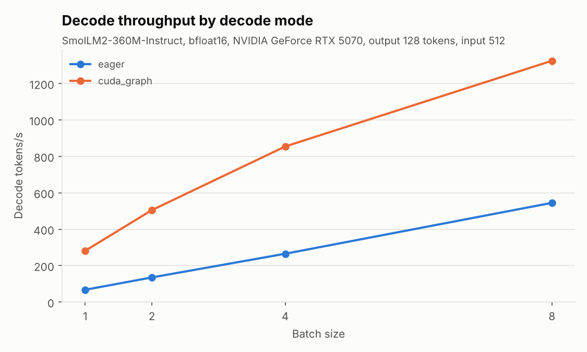
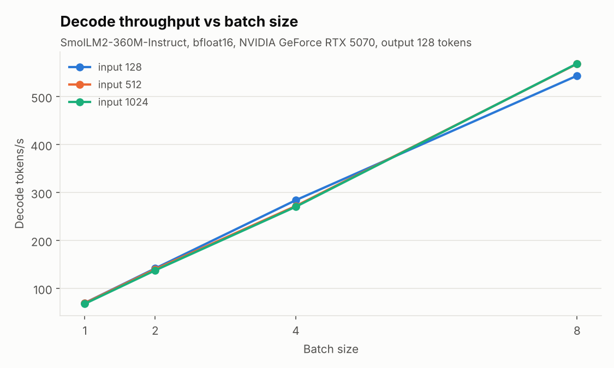
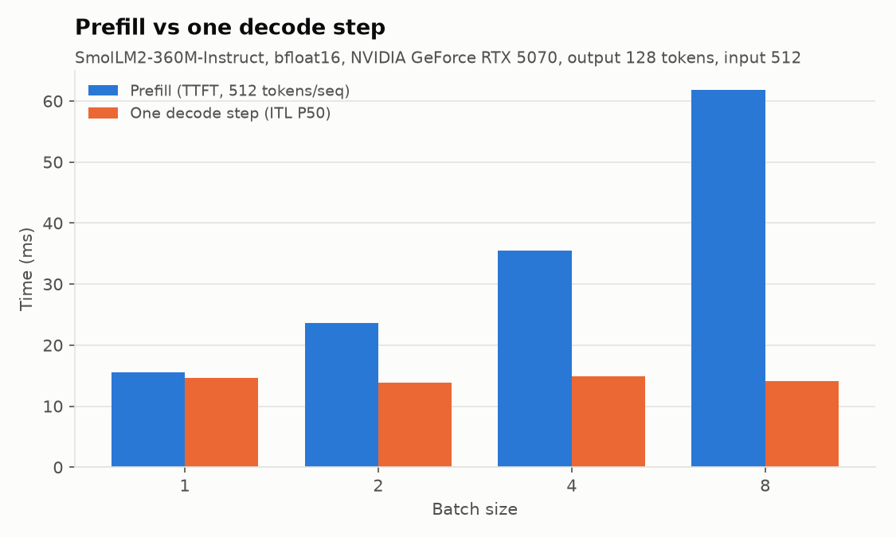
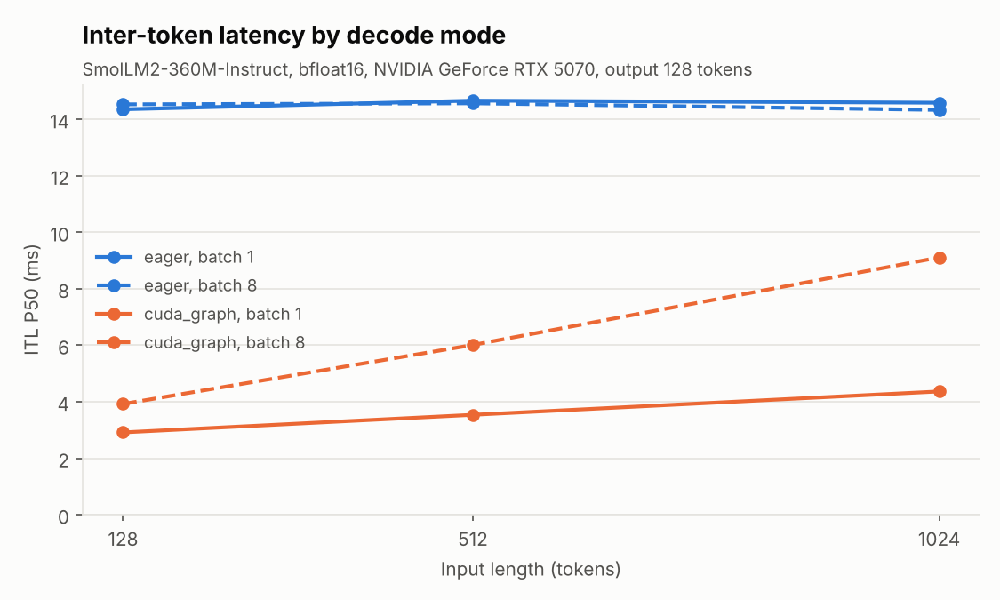
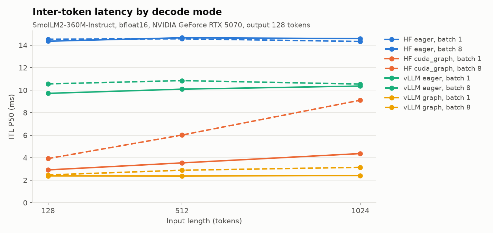

# MiniInferBench

A small, reproducible benchmark harness for LLM inference on a single GPU.

It drives a Hugging Face model with a hand-written prefill + decode loop, times
every step, checks the output token by token against `generate()`, and writes
one classified record per run (config, environment, raw samples, evidence).
Every number below comes from a record in [`results-published/`](results-published/).

## At a glance

On SmolLM2-360M and an RTX 5070 (WSL2):

1. **Found the bottleneck.** Decode was launch-bound: about 1,300 kernel
   launches per step, with the GPU busy only 19% of the time.
2. **Tested the fix and split the credit.** A static KV cache alone made decode
   10% slower; operator fusion cut inter-token latency from 14.8 to 6.0 ms; CUDA
   graphs brought it to 4.1 ms (3.6x faster, GPU busy 95%), with output still
   matching `generate()`. See [the ablation](#ablation-what-each-part-contributes).
3. **The harness caught real bugs.** The token-level check against `generate()`
   found two configuration bugs in the reference itself, and an injected
   host-sync regression showed up in P99 latency (+70%) while the median stayed
   flat.



## Results: SmolLM2-360M on an RTX 5070

Setup: `HuggingFaceTB/SmolLM2-360M-Instruct`, bfloat16, greedy, synthetic
prompts (seeded, fixed length), EOS ignored so every run does the same work.
RTX 5070 12 GB (SM120), WSL2, torch 2.11.0+cu128, transformers 5.22.1.
2 warmup runs + 5 measured runs per point; all records produced at commit
`00da9fe` with a clean tree.

Sweep `5070-360m-v3`: batch {1,2,4,8} x input {128,512,1024} x output {32,128,256}.
All 36 points match `generate()` exactly; 20 are `ok`, 16 `unstable`
(see [Limitations](#limitations)). Full table: `mib table --tag 5070-360m-v3
--results results-published/5070-360m-v3.jsonl`.

| Batch | Input | Output | Status | TTFT (ms) | ITL P50 (ms) | ITL P99 (ms) | Decode tok/s | Peak mem |
| --- | --- | --- | --- | --- | --- | --- | --- | --- |
| 1 | 512 | 128 | ok | 15.50 | 14.58 | 16.94 | 69.65 | 744 MiB |
| 2 | 512 | 128 | ok | 23.67 | 13.89 | 42.00 | 140.27 | 776 MiB |
| 4 | 512 | 128 | ok | 35.46 | 14.86 | 30.66 | 272.14 | 838 MiB |
| 8 | 512 | 128 | unstable | 61.81 | 14.12 | 26.95 | 568.62 | 965 MiB |
| 8 | 1024 | 256 | ok | 135.97 | 14.39 | 17.40 | 561.67 | 1215 MiB |



**Finding 1: decode time is set by the CPU launching kernels, not by the GPU.**

- ITL P50 stays between 13.9 and 14.9 ms at every point with output 128 or
  256, whatever the batch size or input length, so decode throughput grows almost linearly with batch size
  (about 70 → 140 → 272 → 560 tokens/s).
- Profiler traces (`results-published/traces/`) show about 1,300 kernel
  launches per decode step. The GPU is busy for only 3.6 ms (batch 1) to 4.5 ms
  (batch 8) of a ~14.5 ms step.
- Prefill of 128 tokens at batch 1 (TTFT 14.7 ms) costs about the same as one
  decode step: both are dominated by the same per-layer launch sequence.

The direct test of this finding is to remove the launches; see
[Testing the finding with CUDA Graphs](#testing-the-finding-with-cuda-graphs).



More figures: [latency vs batch](docs/figures/latency_vs_batch.png),
[prefill vs input length](docs/figures/prefill_vs_input.png),
[ITL distribution](docs/figures/itl_distribution.png),
[memory: measured vs estimated](docs/figures/memory.png).

## Testing the finding with CUDA Graphs

If decode is launch-bound, replaying each decode step as one CUDA graph
instead of ~1,300 separate launches should cut ITL to roughly the GPU's busy
time. `decode_mode: "cuda_graph"` does that: a static KV cache plus
`torch.compile(mode="reduce-overhead")` for decode steps; prefill stays eager.
Both modes were swept at the same commit, output 128
([`results-published/5070-360m-modes.jsonl`](results-published/5070-360m-modes.jsonl)).

| Batch | Input | ITL P50 eager | ITL P50 CUDA graph | Decode tok/s eager | Decode tok/s CUDA graph |
| --- | --- | --- | --- | --- | --- |
| 1 | 128 | 14.35 ms | 2.92 ms | 69.6 | 341.0 |
| 1 | 1024 | 14.58 ms | 4.37 ms | 67.1 | 228.2 |
| 4 | 512 | 14.73 ms | 4.66 ms | 265.2 | 854.5 |
| 8 | 128 | 14.53 ms | 3.92 ms | 544.8 | 2028.2 |
| 8 | 1024 | 14.33 ms | 9.11 ms | 556.7 | 874.7 |



- **Decode got 1.6x to 4.9x faster**, and at batch 4, input 512 the GPU was
  busy 95% of each step instead of 19%. The batch-1, input-128 ITL of 2.9 ms is
  close to the 3.6 ms of GPU busy time the eager trace showed. But
  `reduce-overhead` does two things at once (operator fusion and CUDA graphs),
  so this sweep alone does not say which one helped. The ablation below does.
- **The bottleneck moved to the GPU.** In eager mode ITL is flat at ~14.5 ms
  whatever the batch or input length. With graphs it grows with both (batch 8:
  3.9 ms at input 128, 9.1 ms at input 1024), because reading the KV cache now
  shows. The largest GPU cost after the matmuls is attention: with a static
  cache SDPA uses the memory-efficient kernel with an explicit mask over the
  full cache length (175 ms total in the trace vs 42 ms for flash split-KV in
  eager mode), so that is the next thing to fix.
- **Correctness under a different kernel path.** 8 of 12 graph-mode points
  diverged from `generate()` somewhere, always between tokens whose logits
  were tied in bf16 or one bf16 step apart (largest gap 0.19 logits, within
  the 0.25 tolerance); a float32 control run at batch 4 matched exactly. These
  points are recorded as `near_tie` with every divergence kept.
- **Costs.** Peak memory is higher (2.2 GiB vs 1.2 GiB at batch 8, input 1024:
  the static cache and the graph memory pool), compilation adds several seconds,
  and graph mode needs longer warmup (6 runs instead of 2).

### Ablation: what each part contributes

Two extra modes isolate the parts: `static` (static KV cache, no compilation)
and `compiled` (static cache plus `torch.compile(mode="default")`: fusion, no
graphs). Same commit, same inputs, output 128
([`results-published/ablation.jsonl`](results-published/ablation.jsonl);
traces for batch 4 in [`results-published/traces/`](results-published/traces/)).

| Mode | What changes | ITL P50, bs4 in512 | ITL P50, bs1 in128 | Kernels per step (bs4) | GPU busy (bs4) |
| --- | --- | --- | --- | --- | --- |
| `eager` | baseline | 14.78 ms | 14.34 ms | 1,334 | 19% |
| `static` | + static KV cache | 16.27 ms (+10%) | 17.07 ms (unstable) | 1,565 | 23% |
| `compiled` | + operator fusion | 6.05 ms (-59%) | 6.53 ms | 579 | 50% |
| `cuda_graph` | + CUDA graphs | 4.05 ms (-73%) | 2.92 ms (-80%) | 580, in 1 graph launch | 95% |

- **The static cache alone is slower.** It is needed for graphs (fixed
  shapes and addresses) but makes SDPA use the memory-efficient kernel with a
  mask over the whole cache, and adds mask and cache-update kernels: 231
  more kernels and ~1.9 ms more GPU time per step.
- **Fusion gives most of the gain.** Inductor fuses 1,565 kernels into 579.
  GPU busy time per step barely changes (~4.0 ms in eager, compiled and graph
  traces), so the saving is launch overhead, which confirms that decode was
  launch-bound.
- **Graphs remove the remaining launches.** The 579 kernels are replayed with
  one graph launch per step. This matters more when the GPU work per step is
  small: at batch 4 graphs take ITL from 6.05 to 4.05 ms, at batch 1 from
  6.53 to 2.92 ms.
- Batch-4 traces published before commit `7911faa` undercount
  `kernel_launches_total` for compiled modes: Triton kernels launch through the
  driver API (`cuLaunchKernel`), which the counter then ignored. Per-step
  kernel counts come from GPU-side events and are unaffected.

## Reference point: vLLM on the same work

To see how far the hand-written loop is from a production engine, `mib vllm`
runs the same grid on vLLM 0.32.0 (separate venv, torch 2.13 + CUDA 13.0):
same checkpoint, same prompt token ids (identical `input_fingerprint`),
greedy, EOS ignored, one static batch, and the same token-level check
against `generate()` before timing (all 24 points exact or near tie).
Output 128 ([`results-published/vllm.jsonl`](results-published/vllm.jsonl);
HF columns from [`5070-360m-modes.jsonl`](results-published/5070-360m-modes.jsonl)).

| Batch | Input | E2E HF `cuda_graph` | E2E vLLM graph | ITL P50 HF `cuda_graph` | ITL P50 vLLM graph |
| --- | --- | --- | --- | --- | --- |
| 1 | 128 | 418.6 ms | 336.9 ms | 2.92 ms | 2.38 ms |
| 1 | 1024 | 590.7 ms | 342.2 ms | 4.37 ms | 2.41 ms |
| 4 | 512 | 632.1 ms | 374.1 ms | 4.66 ms | 2.65 ms |
| 8 | 128 | 545.9 ms | 344.1 ms | 3.92 ms | 2.47 ms |
| 8 | 1024 | 1299.7 ms | 508.6 ms | 9.11 ms | 3.14 ms |



- **At batch 1, input 128 the two graph paths are close** (2.38 vs 2.92 ms
  ITL): with launches gone, little is left to win on a short context.
- **The gap grows with context length.** vLLM's ITL barely moves from input
  128 to 1024 (batch 8: 2.47 to 3.14 ms) while ours triples (3.92 to 9.11 ms).
  This fits the earlier finding that our static-cache attention is the next
  cost, but vLLM was not profiled, so its kernels are not compared here.
- **vLLM eager is faster at the median, worse in the tail.** ITL P50 is
  9.7-10.9 ms (ours: 14.3-14.7 ms) but P99 is 25-37 ms, and 9 of 12 points
  are `unstable`. The cause of those stalls was not investigated.
- **Not the same clock.** HF ITL comes from CUDA events; vLLM ITL from host
  timestamps of `LLMEngine.step()`, which include its scheduler and output
  processing. E2E is a synchronized wall clock on both sides, so it is the
  fairest column. HF records are from an earlier day and torch 2.11; vLLM
  peak memory is not recorded because vLLM preallocates its KV cache.
  Full list of differences: [docs/VLLM.md](docs/VLLM.md).
- **The correctness check caught a vLLM configuration bug.** With
  `min_tokens` set, vLLM masked EOS and picked a token ~7 logits below the
  best at every input-1024 point, the same trap as `min_new_tokens` in HF.

## Case study: can the harness catch a regression?

Two slowdowns are built in behind a config flag; both keep the output
identical, so only timing and traces can reveal them. Batch 4, input 512,
output 128 ([`results-published/regression.jsonl`](results-published/regression.jsonl)).

`mib compare` judges each change against a noise band of max(2%, 3 x the
larger end-to-end CV of the two runs):

| Metric | Baseline | `host_sync_each_step` | `no_kv_cache` |
| --- | --- | --- | --- |
| TTFT mean (ms) | 34.24 | 39.21 (+14.5%, band ±10.7%) | 35.23 (within noise) |
| ITL P50 (ms) | 14.82 | 14.50 (within noise) | 40.65 (+174%) |
| ITL P99 (ms) | 24.73 | **42.18 (+70.5%)** | 56.47 (+128%) |
| E2E mean (ms) | 1948.6 | 1961.4 (within noise) | 5368.3 (+176%) |
| Blocking host calls in trace | 2 | **256** | not traced |

- **No KV cache** recomputes the whole sequence every step: every decode metric
  moves, prefill does not. Easy to catch.
- **A host sync each step** (`token.cpu()`, a common bug when checking for EOS)
  does not move the median at all. Because decode is launch-bound, the GPU has
  usually finished by the time the CPU asks, so the sync is free most of the
  time and stalls only occasionally. It shows up only in the tail (ITL P99) and
  in the trace (blocking host calls 2 → 256, same kernels, same GPU busy time).
  A dashboard that tracks only P50 or end-to-end time would miss it. The TTFT
  change is outside its band, but this regression only touches the decode loop,
  so it is most likely noise.

## The bug the harness caught in itself

The first sweep reported 21 of 36 points as `wrong_result`. The correctness
check now records, for each diverging sequence, the logit margin between the
two tokens on their shared prefix. That evidence showed:

- our loop always picked token 2 (`<|im_end|>`), which the model ranked
  about 7 logits above the reference's choice;
- the divergence was identical in float32, so it was not a precision issue.

The reference was wrong: `GenerationConfig(eos_token_id=None, min_new_tokens=n)`
does not disable EOS. It falls back to the model's EOS, and `min_new_tokens`
then masks it, forcing the runner-up token. Fixed with `eos_token_id=[]`, with
a regression test that fails on the old config.

## How it works

```
config ──> preflight ──> load model ──> correctness check ──> warmup ──> measure
                                          (vs generate())                  │
record (status, manifest, raw samples, evidence) <── stability check <─────┘
```

- **Two clocks.** CUDA events give per-step gaps on the GPU timeline (TTFT,
  ITL); a synchronized wall clock gives end-to-end time. `scripts/timing_pitfall.py`
  shows why: without synchronization a 41 ms GPU workload "takes" 0.18 ms.
- **Correctness first.** A run that does not match `generate()` is never timed.
  Divergences are classified as exact, near tie (both tokens within a
  configurable logit tolerance of the best one) or mismatch, and the logits
  behind that judgement are stored.
- **One status per run.** Failures are classified rather than crashing the sweep.
- **Comparable by construction.** Each record stores a fingerprint of the input
  tokens; `mib compare` refuses runs with different inputs.
- **Resumable sweeps.** Points are keyed by tag; a rerun skips finished points.
  Points whose memory estimate exceeds 90% of free memory are recorded as
  `skipped` rather than attempted.
- **Profiling is a separate pass.** `mib trace` measures its own overhead
  (traced step span was 1.4–1.8x the untraced ITL), so traces are used for
  proportions and kernel breakdowns, not absolute times.

| Status | Meaning |
| --- | --- |
| `ok` | Output matches `generate()`, end-to-end CV within threshold (0.05) |
| `wrong_result` | Output differs from `generate()`; timing is skipped |
| `unstable` | Correct, but end-to-end time varies more than the CV threshold |
| `env_error` | Out of memory, no CUDA, kernel/driver mismatch, download or IO failure |
| `program_error` | Any other exception, with its traceback stored |
| `skipped` | Memory estimate exceeds the safe budget |

## Usage

Requires Linux or WSL2, an NVIDIA GPU, and [uv](https://docs.astral.sh/uv/).

```bash
uv venv --python 3.12
uv pip install -e ".[dev]"      # torch comes from the CUDA 12.8 wheel index
python scripts/check_env.py      # GPU, CUDA, and library versions

mib run --config configs/smollm2_360m_smoke.json     # one run -> results/runs.jsonl
mib rerun <run_id>                                    # same config, new record
mib compare <baseline_run_id> <candidate_run_id>      # changes vs noise band
mib sweep --config configs/smollm2_360m_sweep.json --tag my-sweep
mib table --tag my-sweep && mib plot --tag my-sweep
mib trace --config configs/regression_baseline.json --out traces/baseline
.venv-vllm/bin/mib vllm --config configs/vllm_360m_sweep.json --tag my-vllm   # docs/VLLM.md
```

Development checks (CI runs the same on CPU, with a tiny random Llama; GPU-only
tests are marked `gpu`):

```bash
ruff check . && ruff format --check . && mypy && pytest -q
```

## Limitations

- **Noise.** 16 of 36 sweep points exceed the 0.05 CV threshold, mostly short
  runs (output 32). The first sweep, on the same machine, had 3. During the
  final sweep other long-running processes were using several GB of the WSL
  VM's memory; host-side interference is the likely cause but is not proven.
  Unstable points are kept and labelled, not dropped. GPU clocks stayed at
  ~2880 MHz and 46–57 °C, so thermal throttling is ruled out.
- **WSL2, not native Linux.** The GPU is reached through the WSL2 paravirtualized
  driver and the CPU is scheduled by the Windows host. Since decode here is
  bound by CPU-side kernel launches, absolute ITL on native Linux may well be
  lower; the shape of the results (flat ITL across batch sizes) is expected to
  hold but has not been checked on native Linux.
- **One model, one GPU.** Results describe a small model on one GPU. The vLLM
  numbers are an offline static batch, not vLLM as a server under load
  (no continuous batching or request arrivals), and say nothing about larger
  models or other GPUs.
- **A minimal loop, not `generate()`.** The timed loop has no logits
  processors, stopping criteria or per-step stop check. HF `generate()`
  (transformers 5.22.1) reads its stop flag on the host every step, which is
  the same pattern as the `host_sync_each_step` regression. A quick side check
  (7 runs each, not a published record) had `generate()` about 5% slower end to
  end with identical tokens, so these numbers are a little optimistic for
  users who call `generate()` directly.
- **TTFT in CUDA graph mode has random stalls.** Prefill is eager in both
  modes, yet graph-mode runs show occasional 20-60 ms TTFT outliers (for
  batch 1, input 128, three of five runs). Records report the median TTFT,
  but that point's median is still an outlier; the cause is not yet known.
- **Synthetic prompts, equal length, no padding.** Real traffic is not like this.
- **Correctness is checked against `generate()`**, which is itself code with
  configuration pitfalls (see above). Matching it proves agreement, not truth.

## Related tools

If the question is only "how fast is this model on this GPU", existing tools
answer it: vLLM's benchmark scripts, NVIDIA GenAI-Perf, Hugging Face
optimum-benchmark, and MLPerf Inference for standardized results. Most of them
measure from the outside (send requests, time responses) and are the right
choice for serving load tests or comparing engines.

Engines also ship offline tools that run one fixed batch and look at
kernel-level latency, such as SGLang's `bench_one_batch`. What this project adds is not a capability those tools lack but a
combination aimed at studying one implementation:

- per-step GPU timestamps (CUDA events between tokens);
- a token-by-token correctness check against `generate()` before any timing;
- swappable implementations of the loop itself, which is what made the
  eager / static / compiled / CUDA graph ablation possible;
- a status per run (wrong result, unstable, environment error) instead of
  a number that is always reported.

It is a harness for studying and catching changes in one implementation, not
a replacement for engine-level benchmarks.

## Methodology reference

The measurement methodology (separate prefill and decode, warmup isolation,
per-step timestamps, a separate profiling pass, raw-quantity result logging)
is adapted from the benchmark in [DeepInfer](https://github.com/deepseek-ai/DeepInfer).
DeepInfer's engine targets SM100 and Ascend, so it does not run on this GPU;
the code here is an independent implementation, and its numbers are not
comparable to DeepInfer's.

| DeepInfer idea | Here |
| --- | --- |
| Prefill and decode timed separately | TTFT vs ITL from per-step CUDA events |
| Warmup before measurement | `warmup_runs`, excluded from records |
| N+1 timestamps give N intervals | `EventTimeline.mark()` per token |
| Steps/s vs tokens/s kept apart | `decode_steps_per_s` and `decode_tokens_per_s` |
| Profiler in its own pass | `mib trace`, with measured overhead |
| Raw quantities in JSONL | `raw` field with every sample |

See [docs/PLAN.md](docs/PLAN.md) for the roadmap.
